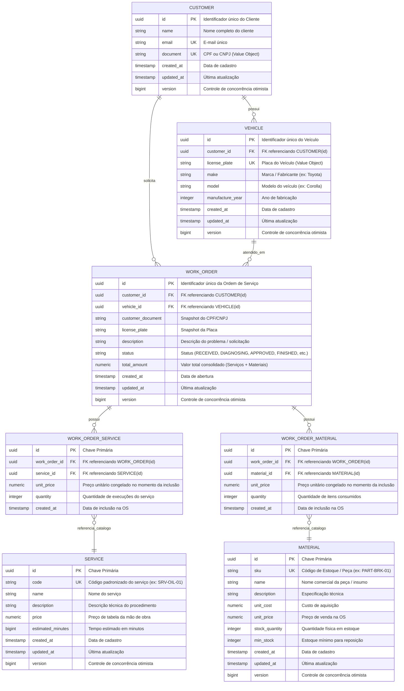

# Microsserviço de Ordens de Serviço (`15soat-phase4-api-work-order`)

Microsserviço responsável pela gestão completa do ciclo de vida das Ordens de Serviço (OS) da oficina mecânica, desenvolvido para o Tech Challenge da Fase 4 da pós-graduação em Software Architecture (SOAT) da FIAP.

## Destaques Arquiteturais

- **Topologia Multi-Módulos (Arquitetura Hexagonal / Ports & Adapters)**:
  - `domain`: Regras puras de negócio, agregados, entidades, *Value Objects*, portas e casos de uso. Isolado e validado rigidamente pela suíte de testes de arquitetura com **ArchUnit**.
  - `application`: Executável Spring Boot 4.0.7, controllers REST, adaptadores de persistência relacional com Spring Data JPA e PostgreSQL, migrations versionadas via **Flyway**, além de produtores e consumidores de eventos Kafka.
- **Design API First**: As interfaces dos controllers (`WorkOrderApi`) são geradas automaticamente em tempo de compilação a partir da especificação `contracts/openapi.yaml` via `openapi-generator-maven-plugin`.
- **Arquitetura Orientada a Eventos Assíncronos**: Contratos de eventos Kafka definidos formalmente em `contracts/asyncapi.yaml`:
  - Emite `WorkOrderApprovedEvent` para iniciar a Saga distribuída de faturamento e produção.
  - Consome `PaymentFailedEvent` para disparar o rollback compensatório seguro da OS.
  - Consome `ExecutionCompletedEvent` para realizar o fechamento e finalização do serviço.
- **Documentação Viva com Swagger UI**: Acesso direto e interativo à documentação da API em `/swagger-ui.html` e `/v3/api-docs`.
- **Padrão Database-per-Service**: Banco de dados relacional dedicado **PostgreSQL** (`work_order_db`) com histórico auditável de migrations Flyway.
- **Testes Realistas com Testcontainers**: Zero dependência de bancos em memória voláteis (H2). Todos os testes de integração sobem instâncias reais de PostgreSQL e Apache Kafka via containers Docker.
- **Suporte a GraalVM Native Image**: Configuração de compilação AOT nativa declarada em Java puro, garantindo subida instantânea e pegada mínima de memória.

## Modelo de Dados & Diagrama Entidade-Relacionamento (MER)

O modelo de dados relacional é persistido no banco PostgreSQL (`work_order_db`) gerenciado via migrations Flyway:

<div style="overflow-x: auto; width: 100%;">
<div style="min-width: 800px;">



</div>
</div>

## Execução Local

### 1. Inicializar Infraestrutura Local (PostgreSQL e Kafka)

```bash
docker compose up -d
```

### 2. Compilar e Executar a Aplicação

```bash
mvn clean package
java -jar application/target/work-order-application-0.0.1-SNAPSHOT.jar
```

Acesse a documentação interativa: `http://localhost:8080/swagger-ui.html`

## 🏛️ Architecture Decision Records (ADRs)

- **[Catálogo de ADRs do Microsserviço](docs/adr/README.md)**: Decisões específicas de Ordem de Serviço (Gestão Mestre de Clientes e Veículos, Modelagem Relacional de Itens com Snapshot de Preços).
- **[Catálogo Global de ADRs (lib-commons)](../15soat-phase4-lib-commons/docs/adr/README.md)**: Padrões transversais compartilhados (Database-per-Service, Saga Kafka, Pragmatic DDD, Tabelas no Singular, Java 25 / Spring Boot 4).
