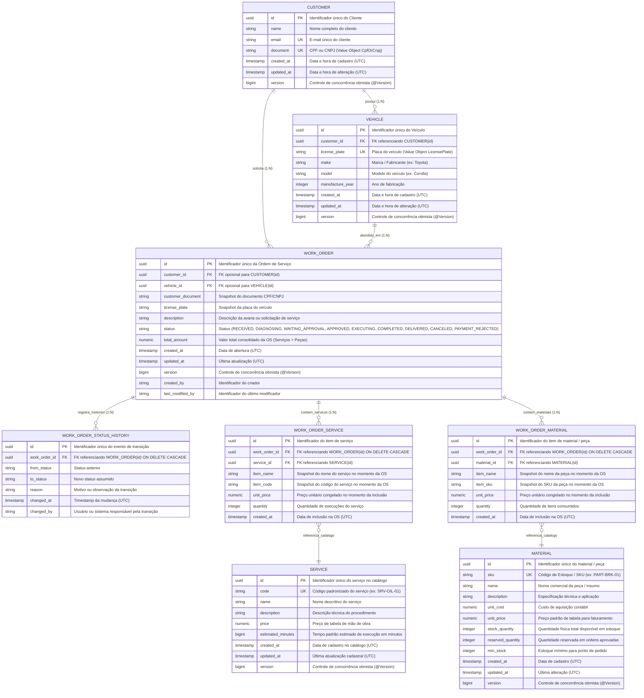

# ADR 0004: Adoção do PostgreSQL Relacional (`work_order_db`) para Integridade Referencial ACID e Gestão de Ordens de Serviço

* **Status**: Aceito (Accepted)
* **Data**: 2026-10-08
* **Escopo**: Microsserviço de Ordens de Serviço (`15soat-phase4-api-work-order`)
* **Herança Arquitetural**: Especializa a **[ADR 0001 da `15soat-phase4-lib-commons`](../../../15soat-phase4-lib-commons/docs/adr/0001-database-per-service-and-polyglot-persistence.md)** (Padrão Database-per-Service e Persistência Poliglota)
* **Autores**: FIAP SOAT Tech Challenge Team
* **Decisores Técnicos**: Equipe de Arquitetura e Engenharia de Software

---

## 1. Contexto e Declaração do Problema

O microsserviço `15soat-phase4-api-work-order` atua como o **núcleo mestre (Core Domain)** do ecossistema da oficina mecânica. Ele é responsável pelo ciclo de vida completo das Ordens de Serviço (OS), pelo cadastro e gestão reutilizável de clientes e veículos, pelo catálogo oficial de serviços e materiais e pelo registro imutável do histórico de transição de status da oficina.

Nesse contexto de negócio, a persistência de dados exige:
1. **Integridade Referencial Estrita**: Uma ordem de serviço só pode existir vinculada a um cliente ativo e a um veículo devidamente registrado no balcão. Um item de OS só pode ser registrado com base em um serviço ou material existente no catálogo.
2. **Garantias ACID e Consistência Imediata**: As operações de triagem, emissão e transição de status da OS exigem atomicidade, consistência e isolamento transacional estritos para evitar ordens corrompidas, estados intermediários inválidos ou concorrência descontrolada entre atendentes e mecânicos.
3. **Imutabilidade e Snapshots Financeiros (ADR 0002 local)**: Ao incluir um item de serviço ou peça na ordem, seu valor monetário e metadados devem ser congelados em tabelas específicas (`work_order_service` e `work_order_material`), protegendo o cliente e a oficina de oscilações futuras no catálogo mestre.
4. **Consultas Complexas e Relacionamentos N:M**: Necessidade de cruzamento eficiente de entidades relacionais (clientes, seus múltiplos veículos, ordens de serviço e seus respectivos itens de catálogo e histórico de fases).

---

## 2. Decisão Arquitetural

Decidimos adotar o **PostgreSQL** como o sistema gerenciador de banco de dados relacional (RDBMS) exclusivo do microsserviço `15soat-phase4-api-work-order`, operando sob a instância isolada **`work_order_db`**:

1. **Padrão Database-per-Service**:
   - O `work_order_db` é completamente desacoplado dos demais microsserviços. Nenhuma outra aplicação (`api-billing` ou `api-exec`) possui acesso direto via JDBC ou credenciais de banco. A integração com outros contextos ocorre exclusivamente via mensageria assíncrona (Apache Kafka) ou APIs REST perimetrais seguras.
2. **Garantia de Integridade Referencial por Foreign Keys**:
   - Todas as relações entre tabelas nucleares (`customer -> vehicle`, `work_order -> customer/vehicle`, `work_order_service -> work_order/service`, `work_order_material -> work_order/material`, `work_order_status_history -> work_order`) são governadas por chaves estrangeiras físicas (`FOREIGN KEY`) com integridade referencial ativa no motor do banco.
3. **Concorrência Otimista com `@Version` (`BIGINT`)**:
   - As entidades principais (`work_order`, `customer`, `vehicle`, `service`, `material`) implementam controle de concorrência otimista através de uma coluna `version BIGINT`, prevenindo *lost updates* quando múltiplos atores (atendente e mecânico) tentarem atualizar o mesmo registro simultaneamente.
4. **Versionamento Estrito de Schema com Flyway**:
   - Todo o DDL do banco de dados é versionado em scripts SQL sequenciais e imutáveis gerenciados pelo Flyway:
     - `V1__init_customer_and_vehicle_schema.sql`: Tabelas `customer` e `vehicle`.
     - `V2__init_work_order_schema.sql`: Tabela nuclear `work_order`.
     - `V3__init_catalog_and_items_schema.sql`: Catálogos `service` e `material` e tabelas de junção com snapshots `work_order_service` e `work_order_material`.
     - `V4__work_order_status_history_and_item_snapshots.sql`: Tabela de auditoria temporal e transição de estados `work_order_status_history`.
5. **Nomenclatura Singular Padronizada (ADR 0004 da `lib-commons`)**:
   - Tabelas declaradas em substantivos no singular e minúsculas (`customer`, `vehicle`, `work_order`, `work_order_service`, `work_order_material`, `service`, `material`, `work_order_status_history`).
6. **Pooling de Alta Performance via HikariCP**:
   - Conexões gerenciadas via HikariCP com desativação mandatória do *Open Session in View* (`spring.jpa.open-in-view=false`) para evitar retenção ociosa de conexões durante serialização HTTP.

---

## 3. Diagrama Entidade-Relacionamento (MER)

---

## 4. Consequências

### Positivas
- **Garantias ACID Fortes**: Elimina o risco de estados inconsistentes, assegurando que transições de fase e itens de OS sejam persistidos de forma atômica e durável.
- **Rigor de Chaves Estrangeiras**: Impossibilidade de órfãos no banco de dados (ex: veículo sem cliente ou item sem ordem de serviço).
- **Auditabilidade e Linha do Tempo**: O histórico relacional de transição de status (`work_order_status_history`) fornece uma trilha completa e imutável do ciclo de vida de cada veículo na oficina com `changed_at` e `changed_by`.
- **Ecossistema Maduro e Performático**: Total compatibilidade com Spring Data JPA, Hibernate 6, pooling HikariCP e migrações DDL determinísticas via Flyway.

### Trade-offs & Mitigações
- **Custo de Migrações de Esquema (DDL)**: Mudanças estruturais exigem migrações SQL cuidadosamente planejadas via Flyway. *Mitigação*: Uso de testes de integração automatizados com Testcontainers PostgreSQL que validam scripts de migração na pipeline de CI.
- **Escala Vertical**: Diferente de bancos distribuídos NoSQL, RDBMS convencionais escalam predominantemente de forma vertical. *Mitigação*: O particionamento em Database-per-Service reduz a carga total, mantendo o `work_order_db` operando em volumes enxutos e de altíssimo throughput.

---

## 5. Referências Canônicas

- **ADR Global 0001 (`15soat-phase4-lib-commons`)**: *Padrão Database-per-Service e Persistência Poliglota (PostgreSQL + MongoDB)*.
- **ADR Local 0002 (`15soat-phase4-api-work-order`)**: *Modelagem Relacional de Itens de Ordem de Serviço com Snapshot Imutável de Preços*.
- **Chris Richardson**, *Microservices Patterns: With examples in Java* (Manning), Capítulo 4 & 5.
- **Martin Fowler**, *Patterns of Enterprise Application Architecture* (Addison-Wesley) — Padrões *Identity Field*, *Foreign Key Mapping* e *Optimistic Offline Lock*.
- **PostgreSQL Global Development Group**, *PostgreSQL 16 Documentation: Concurrency Control and Transaction Isolation*.
