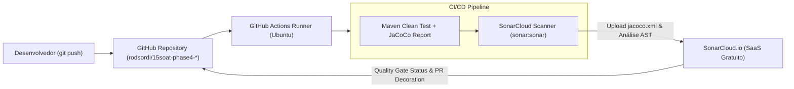

# Plano de Implementação: Configuração do SonarCloud Gratuito no GitHub Actions

> **Decisão do Usuário**: Opção 1 - SonarCloud Gratuito no GitHub Actions
> **Status**: Aprovado para Execução

---

## 1. Visão Geral da Demanda

Integrar e ativar a análise estática contínua de código e cobertura de testes utilizando o **SonarCloud** (100% gratuito para os repositórios públicos do GitHub da organização `rodsordi`), eliminando sobrecarga de memória/CPU no cluster Kubernetes AWS EKS e garantindo compliance com o Quality Gate.

---

## 2. Diagrama de Fluxo CI/CD com SonarCloud

---

## 3. Roteiro Passo a Passo de Execução

### Fase 1: Padronização das Chaves do SonarCloud nos Repositórios
- **Arquivo `ci.yml` dos microsserviços (`api-work-order`, `api-billing`, `api-exec`, `lib-commons`)**:
  - Configurar parâmetros oficiais do SonarCloud:
    - `-Dsonar.host.url=https://sonarcloud.io`
    - `-Dsonar.organization=rodsordi`
    - `-Dsonar.projectKey=rodsordi_<nome-do-repositorio>`
    - `-Dsonar.coverage.jacoco.xmlReportPaths=**/target/site/jacoco/jacoco.xml`

### Fase 2: Configuração do Segredo `SONAR_TOKEN` no GitHub
- Obter o token gerado no SonarCloud em `sonarcloud.io > My Account > Security > Generate Token`.
- Configurar o segredo `SONAR_TOKEN` nos repositórios via GitHub CLI:
  - `rodsordi/15soat-phase4-api-work-order`
  - `rodsordi/15soat-phase4-api-billing`
  - `rodsordi/15soat-phase4-api-exec`
  - `rodsordi/15soat-phase4-lib-commons`

### Fase 3: Ajuste de Exclusões de Cobertura no JaCoCo / Sonar
- Assegurar que DTOs gerados pelo OpenAPI (`**/dto/**`, `**/generated-sources/**`), classes de configuração (`**/config/**`) e a classe de inicialização do Spring Boot (`*Application.java`) estejam devidamente excluídos da contagem de cobertura para não diluir o Quality Gate.

### Fase 4: Validação & Auditoria Sentinela
- Executar teste de compilação e reporte local.
- Submeter a auditoria do subagente `Code Reviewer Sentinel` (**Diretriz Global #7**).
- Solicitar permissão explícita do usuário para commit e push (**Diretriz Global #1**).
